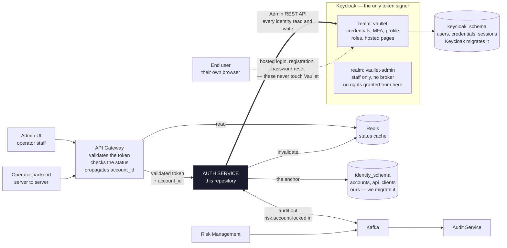
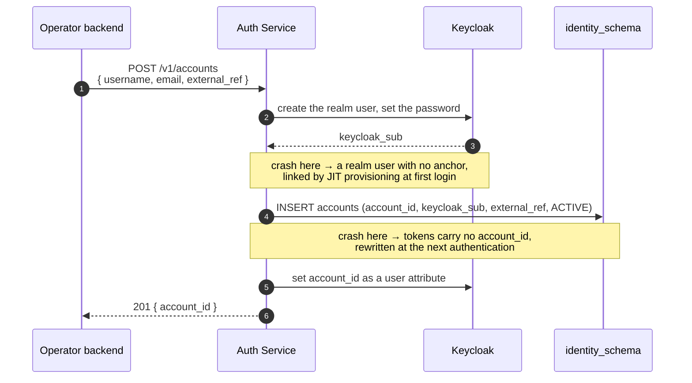
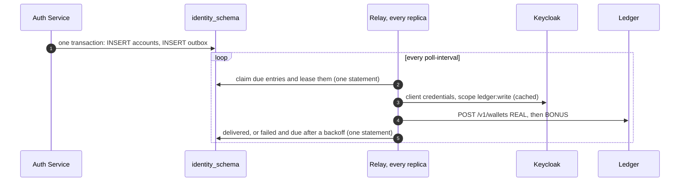
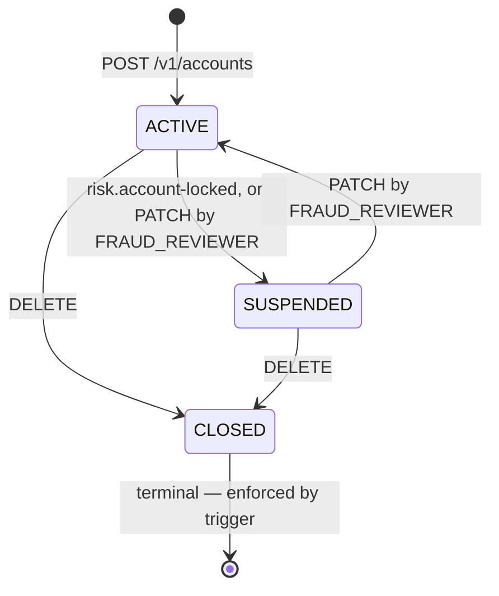
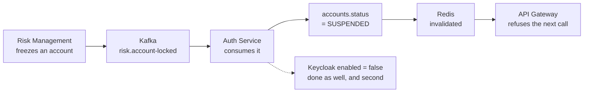

# wallet-auth-service

The account anchor and the identity adapter, per
[ADR-006](../architecture/docs/adr/006-authentication-and-identity.md) and
[ADR-014](../architecture/docs/adr/014-user-management-in-local-identity-mode.md).

This service owns **Vaullet's own record of a user** and brokers everything about that user's
*identity* to Keycloak without keeping a copy.

> ### Keycloak owns the identity. Vaullet owns the account.
>
> Two systems hold two different objects about the same person. Keycloak holds the person who logs
> in — credentials, MFA, email, name, roles. This service holds the thing money is keyed to: an
> `account_id`, a status, and a reference back. Neither is a copy of the other, so neither can go
> stale against the other, and **there is no reconciliation job anywhere in this design.**
>
> Almost every mistake available in this part of the system comes from treating them as one record
> stored twice.

> [!IMPORTANT]
> **Local mode is the default, and the one being built:** Vaullet keeps the users, in its own
> Keycloak realm. The account anchor (step 1) and end users — create with an identity,
> `GET`/`PATCH …/identity`, `DELETE` (the first part of step 4) — are written, tested and live at
> `vaullet.dev/api/auth`. **Admin user management** (#29) — staff under `/v1/staff`, end users
> invited by email, search and password reset — is written and tested; it needs the realm's `staff`
> group (gitops#23) and, for anything that sends email, an SMTP server (gitops#20). Federated mode,
> where an operator's identity provider holds the users, is deferred; step 1 alone never completed
> it, because nothing links a federated user to its account yet. **The account-created outbox**
> (#39) is written and tested: every account is queued for its ledger wallets in the transaction
> that creates it, and they are opened once the ledger is deployed. Read [Build order](#build-order)
> for what exists.

```
./mvnw spring-boot:run     # PostgreSQL, Keycloak and Mailpit via Compose, Flyway migrates, serves on :8080
./mvnw test                # 168 unit + architecture tests, no Docker
./mvnw verify              # adds 152 integration tests on real PostgreSQL and Keycloak
```

Then open <http://localhost:8080/swagger-ui.html>, or the collection in [`bruno/`](bruno) — see
[Calling it by hand](#calling-it-by-hand).

In IntelliJ the run menu offers the same thing in two ready-made configurations, checked in under
`.run/`. Both need Docker running: **auth-service local (compose)** starts PostgreSQL and Keycloak
from `compose.yaml`, like `spring-boot:run`, and **auth-service local (testcontainers)** starts
throwaway ones through Testcontainers. Both run the `local` profile, so no token is needed, and both
debug like any other run configuration. Keycloak has the test realm imported, so the end-user
endpoints work locally too; its admin console is at <http://localhost:58080/admin/> (admin/admin)
for the Compose one. The mail it sends — invitations, password resets — lands in Mailpit at
<http://localhost:58025/> for the Compose run; under Testcontainers it goes to an in-JVM sink that
logs each message with its link.

Locally it is plain HTTP. If the browser shows `ERR_SSL_PROTOCOL_ERROR`, it went to
`https://localhost:8080`, usually because it remembered `https://` from another local app: type
`http://`, or use `http://127.0.0.1:8080`.

Resolving `dev.vaullet:common-*` needs a `github` server in `~/.m2/settings.xml` with a
`read:packages` token — GitHub Packages requires authentication even for a public artifact.

📐 **[Who Owns the User](https://vaullet-dev.github.io/wallet-auth-service/)** — the same material as
a page, with the full component map, a worked account creation, and every field's owner. See
[Rendering the diagrams](#rendering-the-diagrams) if that link 404s; Pages needs turning on once.

---

## Contents

- [What an account is](#what-an-account-is)
- [Who owns which fact](#who-owns-which-fact)
- [The two identity modes](#the-two-identity-modes)
- [The map](#the-map)
- [The API](#the-api)
- [Calling it by hand](#calling-it-by-hand)
- [The schema](#the-schema)
- [Creating an account](#creating-an-account)
- […and the ledger's account row](#and-the-ledgers-account-row)
- [The account-created outbox](#the-account-created-outbox)
- [The account status, and the freeze path](#the-account-status-and-the-freeze-path)
- [Security](#security)
- [End users (local mode)](#end-users-local-mode)
- [Staff (local mode)](#staff-local-mode)
- [Package structure](#package-structure)
- [Build order](#build-order)
- [Deliberate differences from the ledger](#deliberate-differences-from-the-ledger)
- [Releases](#releases)
- [Configuration and profiles](#configuration-and-profiles)
- [Decided, and what each one still needs](#decided-and-what-each-one-still-needs)
- [Rendering the diagrams](#rendering-the-diagrams)

---

## What an account is

There is no wallet service and no user table in the sense most people expect. A user's wallet is
spread across three owners, and each answers a different question:

| Owner | Question it answers | Where it lives |
| --- | --- | --- |
| **Account** — this service | Whose wallet is it, and may it be used right now? | `auth_db`, `identity_schema.accounts` |
| **Ledger** | What money is in it, and can it be spent? | `vaullet_db` ([ADR-004](../architecture/docs/adr/004-atomic-balance-reservations.md)) |
| **Transaction Service** | What did the user do with it? | `transactions_db` |

The account is the first of the three and the only one with no dependencies. Every other service
keys on the `account_id` it mints, across databases, by value — there is no foreign key between any
two of them.

### What the anchor holds, and what it deliberately does not

**Holds:** `account_id`, `keycloak_sub`, `external_ref`, `status`, timestamps. That is the complete
list, in **both** identity modes.

**Does not hold:** email, username, name, phone, date of birth, address, documents, password hashes,
MFA secrets, session state, role assignments. Those are Keycloak's, in its own schema in this same
database, and this service reads them over the Keycloak Admin REST API rather than keeping a copy.

A column added here is a copy of somebody else's record, and copies drift. That is the whole design
in one sentence, and the reason `docs/` exists is that it takes a page to make it obvious.

### Why the anchor exists at all

It is a narrow table and it is easy to argue it away — key everything on Keycloak's `sub` claim and
store nothing. ADR-006 rejected that, and it earns its keep three separate times:

1. **`ledger_entries` is immutable for seven years.** Keying immutable financial records on a
   mutable external identifier guarantees an unfixable migration later. A realm re-import, a change
   of identity provider, or an operator switching their upstream broker all change `sub`. None of
   them may move a balance.
2. **The fraud lock has to be enforceable against the operator's own directory.** If status lived
   upstream, a customer's IdP could overrule a freeze. See
   [the freeze path](#the-account-status-and-the-freeze-path).
3. **GDPR erasure and seven-year retention have to coexist.** Closing an account erases the Keycloak
   user and sets `status = 'CLOSED'`; every journal row stays valid, because it is keyed on an
   identifier that carries no personal data.

---

## Who owns which fact

One rule settles every field: **whoever owns a fact's failure mode owns the fact.** If getting it
wrong is an authentication problem, it is Keycloak's. If getting it wrong is a money problem, it is
ours.

| Fact | Owner | Why it lands there |
| --- | --- | --- |
| Password hashes, MFA enrolment, recovery codes, sessions, failed-login counters, password policy | **Keycloak** | ADR-006 *Alternative 4* decided not to write authentication. Never mirrored, never read, never in a Vaullet backup. |
| Username, email, name, phone, locale, email-verified | **Keycloak** | Registration data it already stores. A second copy buys a sync problem and nothing else. |
| Role assignment | **Keycloak assigns** | …but Vaullet enforces what a role *means*. Separation of duties is ledger and audit state, which no directory can express. |
| `account_id` | **this service** | Keys seven years of immutable journal. It must outlive Keycloak itself. |
| `status` — the freeze | **this service** | A fraud lock the operator's directory can overrule is not a fraud lock. |
| `external_ref` | **this service** | The operator's own user id. Promised unique and immutable to integrators, so it has to be a constraint. |
| Balances, holds, journal | **the ledger** | A different database and a different service, reached only by `account_id`. |

---

## The two identity modes

[ADR-006](../architecture/docs/adr/006-authentication-and-identity.md) sells to two operator shapes,
selected per deployment by `auth.provider` in the customer's Helm values. **User management is not
something an operator buys** — it arrives with `local` and is unavailable under `federated`, where
the operator's own directory does the job.

**`local` is the default and the mode being built.** `federated` is deferred until an operator
brings its own identity provider; a deployment selects it with `AUTH_PROVIDER=federated`.

| | `auth.provider: local` | `auth.provider: federated` |
| --- | --- | --- |
| Who holds the user | Keycloak realm users. Vaullet is the identity provider. | The operator's OIDC or SAML provider, brokered into the same realm. |
| Registration | **Both paths, and an operator may use either or both.** Keycloak's hosted pages for self-service, `POST /v1/accounts` for operator-driven and bulk provisioning. | The operator's own signup. Nothing here is involved. |
| Password and MFA | Keycloak's, configured per realm as declarative YAML. | Upstream. Vaullet never sees a credential at all. |
| Identity sub-resources | Present. | `404 ENDPOINT_NOT_AVAILABLE`, and `/v1/capabilities` says so. |
| `keycloak_sub` at creation | Known immediately — the realm user is made first. | Null. Linked at first authentication. |
| The anchor | Identical — same columns, same constraints, same owner. | ← |
| The freeze | Identical, and authoritative in both. | ← |
| The token | Identical: same realm, same signing key, same claim set. **No other service can tell the modes apart**, which is the entire point of ADR-005's fourth category. | ← |
| PII in a Vaullet table | None. | None. |

---

## The map

Everything that touches a Vaullet user. **This repository is the single dark box.** Everything else
already exists in the cluster for other reasons.



Both schemas live in the one `auth_db`, and **no foreign key crosses between them** — a Keycloak
major upgrade migrates its own tables, and a reference from ours would make that upgrade our problem.

The heavy edge is the one [ADR-014](../architecture/docs/adr/014-user-management-in-local-identity-mode.md)
turns on: **every identity read and write is a live call to the Keycloak Admin REST API**, and
nothing is copied into a Vaullet table. The dashed edge is the end user talking to Keycloak
directly, which is the default — no password ever transits this service.

**Every other service in the platform is absent from this map on purpose.** They sit downstream of
the gateway, receive `account_id` in a validated token, and never call Auth Service at all.

### The facade, and what it costs

The alternative was a local read model of the Keycloak user, kept in sync by a Keycloak event
listener. ADR-014 rejected it and recorded the trigger for revisiting.

|  | Facade (**chosen**) | Local projection (deferred) |
| --- | --- | --- |
| Where a profile read is answered | Keycloak, live | A Vaullet table |
| Can go stale | Nothing to go stale | Yes — needs a rebuild job, a staleness alarm, an out-of-order guard |
| Admin search | Keycloak's search, intersected in the service | One SQL query, joined against `status` |
| PII at rest in Vaullet | None | The copy |
| Survives a Keycloak outage | No (reads fail) | Reads survive |

**The whole bill is admin search.** "Every `SUSPENDED` account with an `@acme.com` address" cannot be
one query, because the two halves live in different systems. Tracked as **R7** in
[`docs/adr/TODO.md`](../architecture/docs/adr/TODO.md) with a named trigger: an admin user list
slower than about a second, or an operator asking for exactly that filter. Because the *writes* are
identical under both designs, adding the projection later changes no API and breaks no integration.

---

## The API

[ADR-012](../architecture/docs/adr/012-external-api-surface.md)'s surface, versioned in the path per
[ADR-011](../architecture/docs/adr/011-api-versioning-and-openapi.md).

**Identity is a sub-resource of the account, not a parallel `/v1/users`.** Two nouns for one
identifier is how the *"Vaullet means both the platform and the ledger service"* problem started,
and a sub-resource puts the ownership boundary in the URL: the account is ours in every mode, the
identity only in local mode.

```
── implemented ─────────────────────────────────────────────────────────────
POST   /v1/accounts        {external_ref}  → 201 {account_id, status, external_ref, linked, …}
                                           | 400 VALIDATION_FAILED | 409 EXTERNAL_REF_TAKEN
                                           | 409 ACCOUNT_CLOSED
GET    /v1/accounts/{id}                   → 200 (same representation) | 404
GET    /v1/accounts/by-ref/{external_ref}  → 200 | 404
PATCH  /v1/accounts/{id}   {status}        → 200  ACTIVE | SUSPENDED | CLOSED
                                           | 409 ACCOUNT_CLOSED | 404

── step 4, local identity mode only ────────────────────────────────────────
POST   /v1/accounts        {external_ref, identity}
                                           → 201, and Keycloak emails the invitation
                                           | 422 EMAIL_DELIVERY_UNAVAILABLE (no SMTP; nothing created)
GET    /v1/accounts/{id}/identity          → 200  from Keycloak, live
PATCH  /v1/accounts/{id}/identity          → 200  to Keycloak
POST   /v1/accounts/{id}/password-reset    → 204  Keycloak sends the mail
                                           | 409 EMAIL_NOT_VERIFIED (can sign in, address unverified)
GET    /v1/accounts?search=  |  ?email=&username=
                                           → 200  {data, next_cursor}, from Keycloak
DELETE /v1/accounts/{id}                   → 204  CLOSED here, erased there

── staff, local identity mode only (#29) ───────────────────────────────────
POST   /v1/staff           {username, email, first_name, last_name, roles, temporary_password}
                                           → 201 {staff_id, username, …, roles, enabled}
GET    /v1/staff                           → 200  {data, next_cursor}
GET    /v1/staff/{id}                      → 200 | 404 (not staff)
PATCH  /v1/staff/{id}      {email?, first_name?, last_name?, enabled?}
                                           → 200 | 403 SELF_CHANGE_FORBIDDEN
PUT    /v1/staff/{id}/roles {roles}        → 200 | 403 SELF_CHANGE_FORBIDDEN
DELETE /v1/staff/{id}                      → 204 | 403 SELF_CHANGE_FORBIDDEN
```

**Lists** are ADR-011 §8's `{"data": [...], "next_cursor": "..."}`, paged with `?limit=` (1–100,
default 50) and `?cursor=`. The cursor is opaque. A page can hold fewer items than the limit and
still not be the last; only a missing `next_cursor` ends the list.

Under `auth.provider: federated` the local-only endpoints return `404 ENDPOINT_NOT_AVAILABLE`, and
`GET /v1/capabilities` reports `user_management: false` — the mechanism ADR-012 §4 already defines
for module-gated resources, reused for a mode-gated one.

**`POST /v1/accounts` takes one field, `external_ref`**, and needs no `Idempotency-Key` because of
it. It deliberately accepts no `keycloak_sub`: no HTTP caller is in a position to know one — in local
mode this service mints the realm user itself (step 4), and in federated mode just-in-time
provisioning supplies it (step 2). The column is nullable for that listener, not for the API.

**The response omits the Keycloak subject too**, reporting `linked: true|false` instead. ADR-006's
central property is that downstream keys on `account_id` and never on `sub`; handing the subject to an
operator invites exactly the coupling the anchor exists to prevent. Creating an account writes to Keycloak *and* to this database with
no transaction spanning the two, so the retry path **is** the recovery path — but the account's own
natural keys make a retry recognisable without a separate one. See
[Idempotency without an idempotency key](#idempotency-without-an-idempotency-key) for why this is the
one endpoint entitled to skip the platform rule.

Wire conventions, all from ADR-011 §7–8:

| | |
| --- | --- |
| Keys | `snake_case` |
| Timestamps | RFC 3339 UTC |
| Errors | RFC 9457 `problem+json` with a stable `code` and a `trace_id` |

```json
{
  "type": "https://docs.vaullet.dev/errors/external-ref-taken",
  "title": "External reference already in use",
  "status": 409,
  "detail": "External reference 'acme-user-8813' is already in use",
  "instance": "/v1/accounts",
  "code": "EXTERNAL_REF_TAKEN",
  "trace_id": "68f0a1…"
}
```

**`code` is the contract; `detail` is for humans.** Branch on `code`, never on the prose.

### This service's error codes

Alongside the platform codes in `CommonErrorType`. Each exists because `RESOURCE_CONFLICT` would
have been technically correct and practically useless: an integrator that gets a 409 from
`POST /v1/accounts` has several different problems to tell apart, and each has a different fix.

| Code | Status | Raised when |
| --- | --- | --- |
| `EXTERNAL_REF_TAKEN` | 409 | Another account carries this `external_ref` **and a different `keycloak_sub`** — two identities claiming one operator id. A repeat with no contradiction is a retry, not this. |
| `IDENTITY_ALREADY_LINKED` | 409 | Another account is already linked to this `keycloak_sub`. Guards the failure ADR-006 names: a subject collision after an IdP migration, producing two accounts for one person and splitting their balance. |
| `ACCOUNT_CLOSED` | 409 | The account is `CLOSED`, and closure is terminal. A 409 rather than a 404 — the account exists and the caller is entitled to know it exists. |
| `USERNAME_TAKEN` | 409 | Keycloak has a user with this username that is not this request's own earlier attempt: another end user, a staff member, or someone who registered on Keycloak's pages. |
| `EMAIL_TAKEN` | 409 | Keycloak has a user with this email address. |
| `EMAIL_NOT_VERIFIED` | 409 | A password reset for a user who can already sign in and whose email address is unverified. The link would reach whoever owns an address nobody has proved — possibly one set a minute ago with `PATCH …/identity`. |
| `IDENTITY_REJECTED` | 422 | Keycloak refused a value — the realm's password policy, or a user-profile validator. `detail` carries Keycloak's reason. |
| `USER_MANAGEMENT_UNAVAILABLE` | 422 | An identity sent to a deployment with `auth.provider: federated`. |
| `EMAIL_DELIVERY_UNAVAILABLE` | 422 | The realm has no SMTP server, so the invitation or reset email cannot go out. Checked before anything is written. |
| `SELF_CHANGE_FORBIDDEN` | 403 | A staff member changing their own roles, disabling themselves or deleting themselves. |

Neither `IDENTITY_ALREADY_LINKED`'s message nor `EXTERNAL_REF_TAKEN`'s names the *other* account. A
caller holding one identifier should not learn another from an error body; that is a cross-system
lookup nobody granted them.

---

## Calling it by hand

[`bruno/`](bruno) is a [Bruno](https://www.usebruno.com) collection of every endpoint, kept in this
repository so a request changes in the same pull request as its endpoint. It is in Bruno's YAML
format, which needs Bruno 3.1 or later: *Open Collection* on the folder.

| Environment | Base URL | Sign-in |
| --- | --- | --- |
| `local` | `http://localhost:8080` | None. The `local` profile runs every request as the anonymous principal with the scopes and roles the rules ask for, and the environment's empty OAuth2 URLs keep Bruno from asking for a token. Mail lands in Mailpit. |
| `prod` | `https://vaullet.dev/api/auth` | The first request opens Keycloak's sign-in page through the demo client `bruno` (authorization code with PKCE). Sign in as staff with `SUPER_ADMIN`, e.g. `test-super-admin`, whose password is in OpenBao at `kv/keycloak/test-users`. |

Before creating anyone in `prod`, set the environment's three secret variables: `end_user_email`
(where the invitation goes), `staff_email` and `staff_temporary_password`. Bruno keeps secret values
on the machine and out of the files, so neither a password nor a personal address reaches git.

*Create staff member* keeps `staff_id`, and *Create end user* keeps `account_id` and `external_ref`,
for the requests under them: a folder run top to bottom creates, reads, changes and removes one user.
Every request asserts its status, so `bru run --env local` in `bruno/` (the CLI, `@usebruno/cli`)
checks a local run end to end. The CLI cannot do the browser sign-in, so it is for `local` only.

**Swagger UI** is at <https://vaullet.dev/api/auth/swagger-ui.html>. *Authorize* offers two schemes:
`bearer-jwt` takes a pasted token, and with `keycloak` Swagger UI signs in itself through Keycloak,
with the public client `swagger-ui`: authorization code with PKCE (from backend-common 1.0.0 and
gitops `realm/26-vaullet-swagger-ui-client.yaml`). Sign in as staff with `SUPER_ADMIN`, e.g.
`test-super-admin`, whose password is in OpenBao at `kv/keycloak/test-users`. Locally, at
<http://localhost:8080/swagger-ui.html>, there is no sign-in: the `local` profile needs no token,
and with no issuer there is no `keycloak` scheme.

---

## The schema

`identity_schema` in `auth_db`, alongside `keycloak_schema`
([ADR-003](../architecture/docs/adr/003-hybrid-database-strategy-with-analytics.md)). **No foreign
key crosses between them.** `keycloak_sub` is a plain `UUID` on purpose: a Keycloak major upgrade
migrates its own tables, and a reference from here would make that upgrade our problem.

**[`docs/schema/`](docs/schema/) is the authoritative description**, generated from a real database:
a throwaway PostgreSQL migrated by Flyway, then the page written from `pg_catalog`. It therefore
shows what the database *ended up with* — the indexes `UNIQUE` created, the form PostgreSQL rewrote
each `CHECK` into, the trigger timing — rather than what the DDL appears to say. The migration itself
is [`V1__identity.sql`](src/main/resources/db/migration/V1__identity.sql).

Since V3 the schema holds a second table, `outbox`: each account's `identity.account-created` event,
written with it — see [The account-created outbox](#the-account-created-outbox). `docs/schema/` has
not been generated again since V1.

```sql
CREATE TABLE accounts (
    account_id   UUID        NOT NULL,
    keycloak_sub UUID        NULL,        -- null = unlinked anchor; set at first authentication
    external_ref TEXT        NULL,        -- operator's own user id; immutable once set
    status       TEXT        NOT NULL,
    created_at   TIMESTAMPTZ NOT NULL DEFAULT now(),
    updated_at   TIMESTAMPTZ NOT NULL DEFAULT now(),

    CONSTRAINT accounts_pk              PRIMARY KEY (account_id),
    CONSTRAINT accounts_keycloak_sub_uk UNIQUE (keycloak_sub),
    CONSTRAINT accounts_external_ref_uk UNIQUE (external_ref),
    CONSTRAINT accounts_status_ck       CHECK (status IN ('ACTIVE','SUSPENDED','CLOSED')),

    -- Every account must be addressable by something other than the id we just minted.
    -- This is what makes creation retry-safe without an idempotency column — see below.
    CONSTRAINT accounts_natural_key_ck
        CHECK (external_ref IS NOT NULL OR keycloak_sub IS NOT NULL),

    -- An empty string is not a missing value. Allowing both gives two spellings of "no operator
    -- reference", one of which silently defeats the constraint above.
    CONSTRAINT accounts_external_ref_not_blank_ck
        CHECK (external_ref IS NULL OR length(btrim(external_ref)) > 0)
);
```

ADR-014 §5, plus two `CHECK`s. **There is no idempotency column**: the natural keys already carry it.

Every column, and why:

| Column | Why it is here |
| --- | --- |
| `account_id` | ADR-004. Keys seven years of immutable journal, so it must outlive Keycloak. |
| `keycloak_sub` | ADR-014, closing **B2**. **Nullable**, and that is not a hole — it is the *unlinked anchor*, an account the operator provisioned for someone who has not authenticated yet. Every reader has to handle it; the ledger never sees it, because it keys on `account_id`. Updatable, unlike `external_ref`: ADR-006 allows a deliberate re-point when an operator migrates IdP. |
| `external_ref` | ADR-012, closing **B3**. Unique and immutable *were* promises with no column to keep them; below they are constraints. |
| `status` | ADR-006. `ACTIVE \| SUSPENDED \| CLOSED`. ADR-006 originally wrote `LOCKED`; ADR-014 renamed it, because ADR-012 had already published `SUSPENDED` to operators **and** because Keycloak uses "locked" for a user its own brute-force detection locked out — a different thing entirely, in the same deployment. |

`UNIQUE` on two nullable columns is deliberate and load-bearing: PostgreSQL treats NULLs as
*distinct*, so any number of accounts may be unlinked or unnamed, while no two may claim the same
identity or the same reference. `NULLS NOT DISTINCT` would break the unlinked anchor on the second
row.

### Idempotency without an idempotency key

`POST /v1/accounts` is retry-safe, and it gets there without the `Idempotency-Key` header that
ADR-011 makes a platform rule for state-changing POSTs. **This is a deliberate deviation, and it is
the only endpoint on the platform entitled to it**, because the resource has natural keys that a
reservation does not: `external_ref` and `keycloak_sub` are both unique, both immutable in practice,
and at least one is always present. A retry is therefore *recognisable from the request itself*.

An account is created for a person who already exists in some other system — the operator's user
table, or the Keycloak realm — so the caller always holds an identifier for them before they hold
ours. A hold has no such prior identity, which is why the ledger needs a key and this does not.

The three cases, resolved entirely from the natural keys:

| Second request arrives with | Meaning | Answer |
| --- | --- | --- |
| The same `external_ref` (or the same `keycloak_sub`), nothing else contradicting | A retry. The operator's user id names the same person it named a moment ago. | `201` with the **existing** account — never a second one |
| The same `external_ref`, a **different** `keycloak_sub` | Two identities claiming one operator id | `409 EXTERNAL_REF_TAKEN` |
| The same `keycloak_sub`, a **different** `external_ref` | One identity claiming two operator ids — ADR-006's subject collision | `409 IDENTITY_ALREADY_LINKED` |

`201` on a replay rather than `200`, matching the ledger: the alternative makes a caller's retry path
behave differently from its first attempt, which is the opposite of what retry-safety is for.

An `Idempotency-Key` header is accepted and logged when sent, so an integrator that puts one on every
POST is not punished for it. It is not stored and not required.

The `CHECK` is what makes all of this hold. Without it an account could be created with neither key,
and *that* request — the one addressable only by the id in its own response — would be the single
un-retryable call in the API.

### Two invariants the database owns

A `BEFORE UPDATE` trigger, not a `RULE`. A rule with `DO INSTEAD NOTHING` makes a forbidden write
*succeed silently*, which is a worse failure than the one it prevents — the ledger has two of those
and they are a wart. These raise `check_violation` (SQLSTATE 23514), so the caller gets a refusal
rather than a lie.

1. **`external_ref` is immutable once set.** ADR-012 tells operators it never changes under them.
   Unless that is a constraint, it is a hope.
2. **A closed account does not reopen.** Closure is an erasure event with an audit trail behind it;
   reviving the row would leave that trail describing something no longer true. A returning user
   gets a new `account_id`.

The service raises `ACCOUNT_CLOSED` *before* the write, so the trigger is a backstop and not the
normal path. Both refuse; only one explains.

---

## Creating an account

Every other operation here is a single call to a single system. Creating a user is **three writes
across two systems with no transaction spanning them**, so it is the one place the split costs
something.



**The answer is not a distributed transaction.** Every step is idempotent, and the repair path
already had to exist: just-in-time provisioning is the only way a *federated* user ever gets an
anchor, so the local-mode create path inherits crash recovery for free. Getting a second use out of
machinery you were already forced to build is usually the sign a boundary is in the right place.

| Fails after | Leaves | Repaired by |
| --- | --- | --- |
| The realm user is created | A Keycloak user with no anchor | JIT provisioning at first login |
| The anchor is inserted | An account whose tokens carry no `account_id` | The attribute write is re-attempted at next authentication |
| Nothing | Nothing | The caller retries; the natural key resolves it to the same account |

### One endpoint, two modes — and why that closes B2

`POST /v1/accounts` means *"make me an account"* in both modes. What differs is how much identity
exists at the time.

- **Local:** create the Keycloak user, then the anchor. `keycloak_sub` is known at insert time.
- **Federated:** insert the anchor alone, `keycloak_sub` null, linked at first authentication.

As ADR-006 and ADR-012 stood, these contradicted each other: JIT provisioning required
`keycloak_sub NOT NULL` while the operator was offered `POST /v1/accounts` for a user who has never
logged in. **The insert failed on the first call of every integration.** Making the column nullable
turns that from a bug into a named state.

### What a replay must check

A retry is resolved against the natural key **and verified against the rest of the request** — see
[Idempotency without an idempotency key](#idempotency-without-an-idempotency-key). A request that
matches on one key and contradicts on the other is a caller bug, not a replay, and it gets a conflict
rather than somebody else's account. The ledger does not check its replays this way on the reserve
path; this service should not copy that.

### …and the ledger's account row

**Creating an account here must create the ledger's row too.** When this was written nothing in the
architecture did: `account_balances` had no creator, and the ledger no create endpoint — the gap the
money-model review surfaced as *"no document says who creates the ledger's account row or its cash
bucket"*. The ledger has since grown wallets, and `POST /v1/wallets` opens an account's `REAL` or
`BONUS` wallet and, with its first, the account itself: `account_balances` and the `CASH` bucket.

Three ways to close it, and the right answer is a combination of two:

| | How | Why not alone |
| --- | --- | --- |
| **A. Synchronous call** | Auth Service calls the ledger before returning `201` | Account creation then fails when the ledger is down, and the write now spans *three* systems with no transaction. It also inverts the dependency: the ledger is the platform's most protected service and should not accept writes from an identity adapter. |
| **B. Event** | Auth publishes `identity.account-created.v1`; the ledger consumes it and inserts the row | Eventually consistent, so a deposit can arrive before the row exists |
| **C. Lazy** | The ledger creates the row on the first credit that touches the account | Satisfies nothing until money moves — and you asked for the row to exist when the account does |

**Do B, and make the ledger's consumer an idempotent upsert on `account_id`.** C then falls out for
free: any credit path upserts the same way, so if money somehow arrives before the event, the row is
created by whichever gets there first and the other becomes a no-op. The window B introduces is
closed by the property that makes B safe to retry in the first place.

The upsert creates `account_balances` **and** the singleton `CASH` bucket, since an account with no
cash bucket cannot be credited and the ledger's own schema says there is exactly one per account.

> [!NOTE]
> **There was no outbox anywhere in this architecture.** Publishing after the commit means a crash
> between the two loses the event permanently — survivable here only by accident, because the first
> deposit repairs it, and the same gap every later event producer would hit. The decision came with
> #39: [an outbox](#the-account-created-outbox), written in the account's own transaction.

**There is no Kafka yet either**, so B arrives in two halves. The event is written today, as a row in
this service's outbox; until there is a broker to publish it to, a relay here delivers it as the two
calls the ledger's consumer would make — `POST /v1/wallets` for `REAL`, then `BONUS` — which are
idempotent exactly as the upsert would be. When Kafka arrives the relay publishes the row instead,
and the ledger's consumer makes the calls. See [The account-created outbox](#the-account-created-outbox).

---

## The account-created outbox

**Every account this service creates gets its ledger wallets, `REAL` and `BONUS`, without anyone
calling the ledger by hand** (#39). The interim decided on 2026-10-14, until there is Kafka:

- a **transactional outbox**: the account's `identity.account-created` event is a row in
  `identity_schema.outbox`, written in the transaction that creates the account;
- a **relay**, running in every replica, that delivers each row as `POST /v1/wallets` for `REAL` and
  then for `BONUS`, and retries until both wallets exist.



It keeps what the event design buys — creating an account never waits for the ledger, and nothing
is lost when either side is down — and postpones one thing: until Kafka, the ledger accepts this one
write from the identity adapter, which option A above objected to. When Kafka arrives the relay
publishes the row to `identity.account-created.v1` instead. The table does not change: each row is
already ADR-007's envelope.

### What is written, and by whom

In the service, a new account's entry is written by `Outbox.accountCreated`, and it **refuses to run
outside a transaction** (`Propagation.MANDATORY`): committed on its own, the entry would bring back
the gap the outbox closes. Every path that creates an account calls it in the transaction that
inserts the anchor. Three writers work outside it, in SQL: V3's backfill and the relay's sweep, for
accounts that already exist, and the demo seed, which inserts its account and its entry in one
statement. The table names them all:

| Path | Where the entry is written |
| --- | --- |
| `POST /v1/accounts` without an identity | `AccountService.create`, in its transaction |
| `POST /v1/accounts` with one, and the repeat that finishes an interrupted create | `EndUserService.create`: the anchor and its entry are one short transaction of their own, with no Keycloak call inside |
| Accounts that existed before V3 | V3's backfill: every account that is not `CLOSED` |
| The demo seed, `k8s/test-users` | its SQL, in the statement that inserts the account |
| **The account at first sign-in (#24)** | must call `Outbox.accountCreated` in the transaction that inserts its anchor — `AccountApiIT` and `EndUserApiIT` show what to assert |
| Anything that slipped through: the previous version's accounts during a rollout, or a path that forgot | the relay's sweep, at its start and every `sweep-interval` |

A replay inserts no account, so it queues nothing. An account whose entry cannot be written is not
created: the two roll back together, and the caller's retry finds nothing half-done.

**The sweep is the backstop for the rollout.** V3 is the first migration this code cannot run
without, so the Deployment is sync wave 1, after the migration Job in wave 0: no pod of this
version starts before the table exists. But the previous version keeps serving until its last pod
stops, and an account it creates after V3's backfill ran gets no entry. The relay queues it — one
`INSERT … SELECT … ON CONFLICT DO NOTHING` (`queue-missing.sql`) for every account that is not
`CLOSED` and has no entry, run when the relay starts and every `sweep-interval` after, safe on
several replicas at once. It normally finds nothing, and says so when it does: a warning, and
`auth_outbox_swept_total`. Finding nothing still means reading every account, which is why it runs
every ten minutes and not every round.

`identity_schema.outbox`, from [`V3__outbox.sql`](src/main/resources/db/migration/V3__outbox.sql):

| Columns | |
| --- | --- |
| `event_id`, `event_type`, `schema_version`, `occurred_at`, `producer_service`, `producer_version`, `correlation_id`, `causation_id`, `account_id`, `payload` | ADR-007 §3's envelope, column for field, as ADR-016 §2 stores it. `identity.account-created` 1.0.0; `occurred_at` is the account's `created_at`; `correlation_id` is the trace id of the request that created it — what its error bodies carry as `trace_id`; `causation_id`, the event that caused this one, is always `NULL` here, because a request creates an account and no event does; `payload` is `{}`, the envelope being the whole fact. Rows the backfill and the seed wrote have no `producer_version`, and those with no request at hand — backfilled, swept, seeded — no `correlation_id` |
| `queued_at` | When the row was written: the account's `created_at` when its own transaction wrote it, later when the backfill or the sweep did. The age of the backlog is measured from here |
| `attempts`, `next_attempt_at`, `last_attempt_at`, `last_error` | Delivery. `next_attempt_at` is also the lease, and the value a claim sets is that lease's token |
| `delivered_at` | `NULL` until both wallets exist in the ledger, or were closed there |

One account-created event per account (a partial unique index), a foreign key to `accounts`, and a
partial index over the pending rows, which is what the relay polls. **Delivered rows stay**: V2's
default privileges gave `auth_app` `SELECT`, `INSERT` and `UPDATE` on the new table and no `DELETE`,
and retention is a decision of its own, not yet made.

**Creating the foreign key locks `accounts` against writes until V3 commits**, backfill included:
the previous version's account inserts and updates wait that long, which is milliseconds at today's
size and grows with the number of accounts. V3 waits at most two seconds to take that lock
(`lock_timeout`); past that it fails and rolls back whole, and the Job tries again, rather than hold
every account write behind some long transaction for as long as that one takes.

### The relay

Every replica runs it, every `poll-interval` from the end of one round to the start of the next.
**No transaction is ever open across a call to the ledger** — a round has three steps, and the two
that touch the database are one short statement each:

1. **Claim.** One statement selects up to `batch-size` due entries `FOR UPDATE SKIP LOCKED`, moves
   each one's `next_attempt_at` a lease ahead, and commits. Two replicas claiming at the same moment
   skip each other's rows, and a row another replica has leased no longer qualifies.
2. **Deliver**, outside any transaction: `POST /v1/wallets` with `{"account_id", "type": "REAL"}`,
   then `BONUS`, and a client-credentials token of `wallet-auth-service` asking for `ledger:write`,
   kept until 30 seconds before it expires.
3. **Record**, one statement per entry, and only while the entry is still under this claim's lease:
   delivered; or failed — `attempts` counted, `last_error` set, and due again after the backoff.

Within a lease, one replica delivers an entry, once. A replica that dies mid-round loses nothing:
its entries come due again when their lease ends. A round stops starting deliveries once what is
left of the lease is shorter than the longest one could take — two calls, each perhaps after a
token, at the configured timeouts — so no entry is still in flight when another replica may claim
it; the relay refuses to start with a lease too short for even one. A repeated delivery would be
harmless anyway, because the ledger answers the opening of a wallet that exists with that wallet,
but nothing relies on it.

**An outcome is recorded only under the lease it was won under.** The arithmetic above holds for
calls that keep to their timeouts; a replica that stalls — a long pause, a database slow to answer —
can still outlive its lease. So the claim hands back the `next_attempt_at` it set, and each outcome
statement requires the entry to still hold it. If another replica has claimed the entry since, the
late outcome writes nothing and counts nothing — it would otherwise have moved that replica's lease
and counted one attempt twice — and says so in a warning.

**Done means both wallets exist**: a `201` for each that names the account and the type asked for,
whether this call opened the wallet or an earlier one did. Nothing else counts — not a `200`, not a
`201` about anything else — because done is final: a `LEDGER_URL` that names some other service
fails every attempt, as an error, rather than mark entries delivered with no wallets behind them.
`409 WALLET_CLOSED` counts as done — the account had the wallet and someone closed it, which is
terminal — and is logged as a warning, since only a person closes a wallet. A failure on `BONUS`
repeats `REAL` next time, which the ledger answers with the wallet it already has. An account
closed before its entry is delivered still gets its wallets: the event is that it was created.

**A `401` from the ledger drops the token** the relay showed it, so the next attempt asks Keycloak
for a new one rather than repeat a refused token until it expires.

**Backoff**: 10 seconds after the first failure, doubling, at most 15 minutes — and an entry is
never given up on, because financial events are never dropped (ADR-007 §10). A day of failures is
about a hundred attempts, and an entry is delivered within a quarter of an hour of the ledger
coming back.

**The sweep** runs beside the rounds, at the relay's start and every `sweep-interval`, and queues
what [nothing else queued](#what-is-written-and-by-whom).

### Configuration

| Property | Environment | Default | |
| --- | --- | --- | --- |
| `auth.outbox.relay.enabled` | `AUTH_OUTBOX_RELAY_ENABLED` | `true`; `false` in `local`, `test` and `migrate` | The switch. Off, entries still queue; on again, everything queued is delivered |
| `auth.ledger.url` | `LEDGER_URL` | — | The ledger's in-cluster Service, `http://ledger-service.wallet-ledger.svc`; it has no public route. Required while the relay is on |
| `auth.ledger.timeout` | | `5s` | Connect, and then read |
| `auth.outbox.relay.poll-interval` | `AUTH_OUTBOX_POLL_INTERVAL` | `5s` | From the end of one round to the start of the next |
| `auth.outbox.relay.batch-size` | `AUTH_OUTBOX_BATCH_SIZE` | `20` | Due entries one round claims |
| `auth.outbox.relay.lease` | | `2m` | Must exceed one delivery: 40 s with the default timeouts |
| `auth.outbox.relay.initial-backoff`, `max-backoff` | | `10s`, `15m` | |
| `auth.outbox.relay.sweep-interval` | `AUTH_OUTBOX_SWEEP_INTERVAL` | `10m` | How often the sweep runs, after once at start |

The token endpoint is Keycloak's in-cluster URL (`KEYCLOAK_URL`, `/auth` included) plus
`/realms/<realm>/protocol/openid-connect/token`, and the client is the Admin API's
(`KEYCLOAK_CLIENT_ID`, `KEYCLOAK_CLIENT_SECRET`) — so those are required while the relay is on, **in
either identity mode**. `ledger:write` must be an optional client scope of that client (gitops#30):
the relay asks for it, and the Admin API's token, which does not, stays as it was.

**On in production** (`k8s/deployment.yaml` sets the switch and `LEDGER_URL`), and by default, so a
deployment that forgot the URL fails at startup rather than queueing in silence. **Off locally**:
`compose.yaml` runs no ledger and its realm's client does not offer `ledger:write`, so every attempt
would fail, one log line per account per backoff. Entries still queue, and with a ledger to hand,
`AUTH_OUTBOX_RELAY_ENABLED=true` and `LEDGER_URL` deliver them. **Off in tests**, so nothing polls
the shared database behind a test's back — `OutboxRelayIT` builds its relays against stand-ins and
runs their rounds itself, and `OutboxRelayApplicationIT`, which runs the relay as production does to
show the schedule works, does it in a context of its own, closed after it. **Off in the migration
Job**, which migrates and exits.

### When deliveries back up

Until the ledger is deployed (wallet-ledger-service#12), every entry waits and retries. That is the
expected state, not an incident.

**Metrics**, at `/actuator/prometheus`:

| Metric | |
| --- | --- |
| `auth_outbox_pending` | Entries not yet delivered. Read from the database at each scrape, so it is right even on a replica whose relay is off |
| `auth_outbox_oldest_pending_seconds` | How long the oldest has waited — the one to alert on |
| `auth_outbox_delivered_total` | Entries this replica delivered |
| `auth_outbox_failed_total{reason}` | Failed attempts on this replica: `unavailable` mends itself, `refused` needs a person |
| `auth_outbox_swept_total` | Accounts this replica's sweep found without an entry, and queued |

**Logs.** `Outbox relay on: a round every …, a sweep every …` at startup. Per entry, `Opened the
REAL and BONUS wallets of account …` (INFO), `Could not open the wallets of account …; retrying in
…` (WARN, `unavailable`), or `The wallets of account … were refused … this will not heal by itself`
(ERROR, `refused`). Each names the account, the event and the correlation id, so one search for a
request's trace id finds its delivery attempts too. `Queued … account(s) that had no account-created
entry` (WARN) is the sweep finding something. `Lost the lease on event …` (WARN) is a delivery that
outlived its lease: another replica claimed the entry meanwhile and records it, and this one counted
nothing. Once is a pause; often, the lease is too short for the timeouts.

**The table**, as `auth_app` or any role that can read `identity_schema`:

```sql
-- How far behind, and since when
SELECT count(*) AS pending, min(queued_at) AS oldest, max(attempts) AS most_attempts
  FROM identity_schema.outbox
 WHERE delivered_at IS NULL;

-- Why: the errors, most frequent first
SELECT last_error, count(*), max(last_attempt_at) AS last_tried, min(next_attempt_at) AS next_try
  FROM identity_schema.outbox
 WHERE delivered_at IS NULL
 GROUP BY last_error
 ORDER BY count(*) DESC;

-- Once the cause is fixed, try again now rather than after the backoff: the next round takes them.
-- Only entries due more than a lease (auth.outbox.relay.lease, 2m) from now: no lease reaches that
-- far, so none of them is being delivered. The rest are due within the lease anyway.
UPDATE identity_schema.outbox
   SET next_attempt_at = now()
 WHERE delivered_at IS NULL
   AND next_attempt_at > now() + interval '2 minutes';
```

An account with no entry at all needs no query of its own: the sweep queues it within a
`sweep-interval` of the relay running, and a relay that is off delivers nothing anyway.

**What `last_error` means:**

| `last_error` | Meaning | What to do |
| --- | --- | --- |
| `Upstream 'ledger' is unavailable: I/O error …` | Nothing answers at `LEDGER_URL`: the ledger is not deployed, not running, or the URL is wrong | Nothing until wallet-ledger-service#12; after that, the ledger's pods, and `LEDGER_URL` |
| `Upstream 'ledger' is unavailable: HTTP 503 ACCOUNT_BUSY …` | Lock contention on the account in the ledger | Nothing: it retries |
| `Upstream 'ledger' is unavailable: HTTP 5xx …` | The ledger is unwell | The ledger's logs |
| `The ledger refused POST /v1/wallets … with HTTP 401` or `403 ACCESS_DENIED` | The ledger does not accept the token: it lacks `ledger:write`, or comes from an issuer the ledger does not trust. A `401` drops the token, so one that heals on a new token is gone by the next attempt; one that stays is configuration | gitops#30; the ledger's `OAUTH2_ISSUER_URI` |
| `Keycloak refused the client credentials … invalid_scope …` | The client does not offer `ledger:write` | gitops#30 |
| `Keycloak refused the client credentials … unauthorized_client` or `invalid_client` | Wrong secret, or the client's service accounts are off | `kv/wallet-auth/keycloak-client`, and the client in gitops |
| `Keycloak's token endpoint answered HTTP 404 …`, `403 …`, a `3xx` | `KEYCLOAK_URL` without Keycloak's relative path (`/auth`), a realm that is not there, or something in front of Keycloak | `KEYCLOAK_URL`, `KEYCLOAK_REALM` |
| `Upstream 'keycloak' is unavailable` | Keycloak did not answer, or answered `408`, `429` or `5xx` | Keycloak |
| `Unexpected HTTP 201 … not the wallet asked for`, `Unexpected HTTP 200 …` | Something other than the ledger answers at `LEDGER_URL`, and answers yes | `LEDGER_URL` |
| `Unexpected HTTP 400 VALIDATION_FAILED …`, `404 …` | The two services disagree about the contract, or `LEDGER_URL` names another service | `LEDGER_URL`, and the ledger's version |

### Not yet

- **Kafka.** The relay publishes the row to `identity.account-created.v1` (ADR-007), keyed by
  `account_id`, and the ledger's consumer opens the wallets. architecture#3 records the interim
  meanwhile: ADR-016, which amends ADR-007 (§11) and ADR-014 §7 to match.
- **Retention.** Delivered rows accumulate, a few hundred bytes each, and nothing here may delete
  them.
- **[`docs/schema/`](docs/schema/)** is generated, and needs generating again: it still shows V1 only.

---

## The account status, and the freeze path



The freeze is the one sequence that explains the whole design. It runs identically in both modes, it
never asks the operator's directory for permission, and it is the reason `status` cannot live in
Keycloak.



**Keycloak's `enabled` flag is not the primary control**, and this is worth being explicit about
because it is the obvious-looking shortcut. Disabling a Keycloak user stops *new* logins but does
not invalidate a token already issued — a frozen user would keep transacting for up to the token
lifetime, fifteen minutes. It would also require Risk Management to hold write credentials against
the directory, giving a sellable module administrative authority over it. And under brokering, the
upstream IdP re-asserts the user at next login.

So **Vaullet will refuse a user the operator's own identity provider still considers perfectly
fine.** That asymmetry is deliberate, it has to be in the contract and in the operator's runbook, and
it only works because the authoritative status sits in a table we own.

---

## Security

This service validates tokens exactly like every other service does. **Keycloak is the only signer
in the platform** (ADR-006); this service brokers and never mints. If it ever needed its own token
handling, something would have gone wrong.

Scopes, for [ADR-008](../architecture/docs/adr/008-service-to-service-authentication.md)'s Layer 3
table, which has the `/v1/accounts/**` rows and still needs `/v1/staff/**` (architecture#2):

| Scope | Covers |
| --- | --- |
| `identity:read` | `GET /v1/accounts/**`, `GET /v1/staff/**` |
| `identity:admin` | `POST`, `PATCH`, `PUT`, `DELETE` on both |

Roles are realm roles from `realm_access.roles`, mapped to `ROLE_*` by `backend-common`'s
`JwtAuthorityMapper`. **Keycloak assigns them; this service enforces what they mean.**

| Endpoint | Role |
| --- | --- |
| `POST /v1/accounts`, the identity sub-resources, password reset, `DELETE` | `SUPER_ADMIN` |
| `PATCH /v1/accounts/{id}` — the freeze | `FRAUD_REVIEWER` |
| `GET /v1/accounts/**`, search included | `SUPPORT_AGENT` and up: every ADR-006 role except `END_USER` |
| Everything under `/v1/staff`, reads included | `SUPER_ADMIN` |

**Every rule needs the role, reads included.** A scope says what the client may ask for, not who
the user is: Keycloak puts a client scope in the token of everyone who signs in through a client it
is attached to, `END_USER`s included. So `identity:read` on its own admits anyone the client admits,
and it is the role that says who is asking. Each rule is written once, in `AccountAccess`, and both
`AccountService` and `EndUserService` use them; staff management's are in `StaffAccess`.

**The freeze deliberately sits on a different endpoint from user administration.** Two endpoints,
two roles, two audit streams — ADR-006's separation of duties comes out of the resource layout
rather than being enforced on top of it. Keep it that way: folding the status change into
`PATCH …/identity` would quietly hand user administrators the ability to un-freeze a fraud case.

`@PreAuthorize` goes on the **service** methods, not the controllers. The ledger puts them on
controllers and its own code says they belong a layer down; this service has no such history, and
step 2 adds a Kafka listener that must be governed by the same rules without a second copy of them.

**This service now calls the ledger, with `ledger:write`.** The outbox relay's token is the
`wallet-auth-service` client's, asking for the optional scope `ledger:write` (gitops#30). The relay
calls `POST /v1/wallets` and nothing else, but the scope reaches further: the ledger checks scopes
only, so whoever holds that token could also place and release holds, and freeze or close any
wallet (the ledger's README, "Known gaps"). The token lives in this process, beside the
realm-management credentials it already holds; a narrower scope for opening wallets would make
"opens wallets and nothing else" a property instead of a habit.

---

## End users (local mode)

In local mode, the default, this service creates end users itself: a Keycloak user and its account,
together (ADR-014 §6). `POST /v1/accounts` takes an optional `identity`; without one it creates the
anchor alone, as before.

```json
{
  "external_ref": "acme-user-8813",
  "identity": {
    "username": "jane.doe",
    "email": "jane.doe@example.com",
    "first_name": "Jane",
    "last_name": "Doe"
  }
}
```

**No password — an invitation.** Keycloak emails the new user a link to set their own password
(`execute-actions-email` with `UPDATE_PASSWORD`), valid for `auth.user-management.email-link-lifespan`,
72 hours by default. The password is typed into Keycloak's page, so no end user's password passes
through this service, and following the link verifies the address as well. An earlier version
accepted a temporary `password`; one still sent is ignored like any other unknown field.

**Without SMTP, nothing is created.** The realm's SMTP server is checked before the first write, and
a realm without one answers `422 EMAIL_DELIVERY_UNAVAILABLE`: a user who cannot be invited is a user
who cannot sign in. Production has no SMTP server until gitops#20 (Mailjet), so until then this
endpoint refuses end users there.

**The order is what makes a repeat safe.** The account id is minted first and the Keycloak user is
created carrying it as `account_id`, so the anchor's primary key and the token claim are one value
from the start. Then the anchor row, which is the commit point, then `END_USER`, then the invitation.
A create that died between Keycloak and the database is finished by the retry: Keycloak answers 409,
and a user with an `account_id` and the requested email address is recognised as this request's own.
A repeat sends the invitation again for as long as the user has no way to sign in — no password and
no linked identity provider — so a lost invitation goes out again, and a replay of a create long
finished emails nobody. Details in `EndUserService`.

`GET`/`PATCH /v1/accounts/{id}/identity` read and change the Keycloak user; nothing is stored here.
`POST /v1/accounts/{id}/password-reset` sends the same email again, for a forgotten password or an
invitation that expired. Once the user can sign in, it goes only to a verified address and answers
`409 EMAIL_NOT_VERIFIED` otherwise: `PATCH …/identity` sets addresses nobody has proved yet, and
changing the address and then sending a reset would hand the account to whoever owns the new one. A
user who cannot sign in yet still gets it — for them it is the invitation again. `DELETE
/v1/accounts/{id}` closes the account and deletes the Keycloak user. `account_id` and everything
keyed to it stay.

**Search** is `GET /v1/accounts`. `?search=` is Keycloak's free text — a prefix of the username, the
email address or a name, with `*` as a wildcard — while `?email=` and `?username=` are exact, and the
two kinds do not mix. It is answered from Keycloak in username order and joined to the accounts a
batch at a time, each account with its `identity`. Staff and users with no account are skipped, so a
page can be short without being the last, and closed accounts are not found: their identity went
with them.

**What the realm must provide** (gitops, `apps/keycloak-config`):

- a confidential client `wallet-auth-service` with service accounts on and every flow off, whose
  service account holds realm-management `manage-users`, `view-users` and `view-realm`;
- `account_id` declared in the user profile with **edit for admin only**. Undeclared, Keycloak
  drops the attribute silently; user-editable, a user could change which account their tokens name.
  The service checks this before its first create and refuses to continue otherwise;
- the client's secret in OpenBao at `kv/wallet-auth/keycloak-client` (`secret`), read here by
  `k8s/externalsecret-keycloak-client.yaml` and by keycloak-config-cli in the `keycloak` namespace;
- an SMTP server in the realm, for invitations and resets (gitops#20). Without one those answer
  `422 EMAIL_DELIVERY_UNAVAILABLE`;
- the realm group `staff` (gitops#23) and ADR-006's six realm roles, for staff management.

The Admin API is called on Keycloak's in-cluster Service, never through `vaullet.dev/auth`.

---

## Staff (local mode)

The operator's own people — support agents, fraud reviewers, finance, configuration admins and
super admins — are realm users too, managed under `/v1/staff` for the admin dashboard (#29). They
live in realm `vaullet` beside the end users, a departure from ADR-006's separate `vaullet-admin`
realm that architecture#2 records, and they have **no account**: no wallet, so no anchor and no
`account_id`. A staff member's id is their Keycloak id, which is also the `sub` of their tokens.

```json
POST /v1/staff
{
  "username": "ana.support",
  "email": "ana@operator.example",
  "first_name": "Ana",
  "last_name": "Kovač",
  "roles": ["SUPPORT_AGENT"],
  "temporary_password": "set by the admin, replaced at first sign-in"
}
```

**Who is staff is a group, not a role.** Every staff member is created in the realm group `staff`,
in the same Keycloak call that creates the user. Roles cannot be given in that call, so staff marked
by their roles alone would make a create that stopped half-way produce somebody invisible, holding
the username. Membership makes them visible from the first write, and a repeat of the create grants
the roles it missed. Every `/v1/staff` operation refuses a user outside the group, so an end user
cannot be reached through it — and staff, having no account, cannot be reached through
`/v1/accounts`.

**First sign-in.** The password is temporary and the member must enrol an authenticator app: Keycloak
runs `UPDATE_PASSWORD` and `CONFIGURE_TOTP` before it issues them a token, which is ADR-006's MFA for
every role but `END_USER`. A password grant for such a user answers *Account is not fully set up*;
the first sign-in happens in a browser.

**The caller is checked in Keycloak, not only in their token.** Everything under `/v1/staff` is
`SUPER_ADMIN`'s, and `@PreAuthorize` reads the roles a token carried when it was issued. For the
writes that is not enough — a `SUPER_ADMIN` demoted or disabled a minute ago could use the rest of
their token's life to make themselves a way back in — so each write also asks Keycloak whether the
caller is, now, an enabled member of the `staff` group holding `SUPER_ADMIN`, and answers
`403 ACCESS_DENIED` if not. A token without a usable `sub` is refused the same way: the client
behind the dashboard needs Keycloak's `basic` client scope, which is where `sub` comes from. So is
any caller that is not a Keycloak token at all, the local profile's anonymous one aside — an
authentication that cannot say who its holder is must not switch these checks off.

**Nobody administers themselves.** Changing your own roles, disabling yourself and deleting yourself
answer `403 SELF_CHANGE_FORBIDDEN` — separation of duties: a `SUPER_ADMIN` must not be able to grant
themselves `FINANCE`. With the live check, whoever removes a `SUPER_ADMIN` is another one who still
is, so the last cannot be removed; only two removing each other at the same moment could do it.
Every write is logged with the caller's id, for the audit trail ADR-006 asks of role changes, until
the Audit service exists to take it.

`PUT /v1/staff/{id}/roles` replaces the set, revoking before granting so a half-finished change leaves
less access rather than more; it takes effect at the member's next token. `PATCH` with
`"enabled": false` switches a leaver off and ends their sessions. `DELETE` removes them for good,
along with the name anything they did was recorded under.

**Not yet guarded:** `/v1/accounts` reaches users only through their account, and staff have none —
so today an end-user operation cannot touch a staff member. The account at first sign-in (#24) must
keep it that way by never giving a member of `staff` an account.

---

## Build order

ADR-014's order, because each step is independently useful and the first one unblocks other repos.

| # | Step | What it delivers | State |
| --- | --- | --- | --- |
| 1 | **The anchor** — migration, DAO, service, `POST`/`GET /v1/accounts`, `by-ref`, `PATCH` status | What both modes stand on. 25 main sources, 45 tests | ✅ **done** 2026-09-17 |
| 2 | Token validation, the `account_id` protocol mapper, JIT provisioning, and the `identity.account-created.v1` producer | Tokens carry `account_id`; the unlinked anchor gets linked; the ledger gains its `account_balances` row | ⬜ **next** |
| 3 | Status enforcement and the Redis-cached gateway check | The freeze takes effect | ⬜ |
| 4 | The Keycloak admin client and the identity sub-resources | Local mode's user management — the facade | 🟡 **end users** (#17) live: create with an identity, `GET`/`PATCH …/identity`, `DELETE`. **Admin user management** (#29) written and tested: invitations instead of passwords, search, password reset, staff. The account at first sign-in (#24) follows |
| 5 | `api_clients` and token exchange (RFC 8693) | Operator server-to-server integration | ⬜ |

Nothing else in the platform depends on steps 4 or 5, which is why they are last despite being the
part this service is named after.

The `identity.account-created` producer went in ahead of step 2, as [the account-created
outbox](#the-account-created-outbox) (#39): every account is queued with its event today, and the
relay delivers it over HTTP as the ledger's `POST /v1/wallets` until there is Kafka. What step 2
adds to it is the publisher.

### Deliberately not now

- **A local read projection.** Rejected as ADR-014's *Alternative 1*, with the trigger recorded as
  **R7**. Additive later; costs nothing to defer.
- **Bulk import.** A local-mode operator migrating from an existing system needs it and will drive a
  per-user REST loop until it is designed.
- **End users editing their own profile.** That is Keycloak's account console, not our API.

---

## Package structure

```
dev.vaullet.auth
├── AuthApplication.java              entry point: @SpringBootApplication and nothing else
├── package-info.java                 @NullMarked
│
├── common/
│   ├── error/                        this service's share of the error vocabulary
│   │   ├── AuthErrorType.java        the codes in "This service's error codes"
│   │   ├── AuthApiExceptionHandler.java  the shared advice, plus one DuplicateKeyException backstop
│   │   └── exception/                the concrete throwables
│   ├── api/                          what a list looks like on the wire: ListResponse, Cursors,
│   │                                 PageParameters — part of the API layer by name
│   └── paging/                       Slice, one page as a service hands it back
│
├── account/                          ← the feature slice
│   ├── api/v1/                       controllers + dto/ — versioned, because ADR-011 §4 runs v1 and
│   │                                 v2 side by side for twelve months
│   ├── service/                      AccountService, EndUserService, Account, AccountStatus,
│   │                                 NewAccount, validation/ — rules, transactions, authorisation
│   └── dao/                          AccountRepository + AccountStatements — every statement on the
│                                     accounts table — and KeycloakUsers, the Admin API both slices
│                                     share, with KeycloakTokens
│
├── outbox/                           ← the account-created outbox (#39)
│   ├── service/                      Outbox, the one way an entry is written; OutboxRelay, Backoff
│   │                                 and OutboxRelaySchedule, which deliver it
│   └── dao/                          OutboxRepository + OutboxStatements, and LedgerWallets — the
│                                     ledger's POST /v1/wallets, with a token of its own
│
└── staff/                            ← staff management (#29)
    ├── api/v1/                       StaffController + dto/
    └── service/                      StaffService, StaffMember, StaffRole — no dao of its own
```

**The SQL is not in the Java.** `db/sql/accounts/*.sql` holds the six statements, and
`db/sql/outbox/*.sql` the outbox's five, loaded eagerly at startup by `AccountStatements` and
`OutboxStatements` so a renamed file fails the context rather than an endpoint. The
reasoning for each one lives in the file with it, which is also where it is useful: SQL comments reach
the server, so a statement misbehaving in `pg_stat_activity` names its own source file.

**Only the API layer is versioned.** ADR-011 versions the wire, not the domain, and the separate DTO
types are what let the two move independently. A `/v2` needing its own `AccountService` would mean the
version boundary was drawn in the wrong place.

**Every package carries its own `package-info.java`** with `@NullMarked`. Java packages do not nest
for annotation purposes — `spring-core` ships fifty of these files for the same reason — so the
declaration at the root reaches only `AuthApplication`.

**No records.** Classes throughout: `AccountRow`, `Account`, `NewAccount` and the DTOs. `Account`'s
`equals` is identity-only — the same account with a changed status is still the same account — which
value-equality across all six fields would have got wrong.

---

## Deliberate differences from the ledger

Same template, same platform library, same three layers (`api` → `service` → `dao`) enforced by
ArchUnit. Where this service departs, it is on purpose, and mostly because the ledger has already
demonstrated the cost.

**1. The status guard lives in the `WHERE` clause, never in a preceding read.**

```sql
UPDATE accounts SET status = ?, updated_at = now()
 WHERE account_id = ? AND status <> 'CLOSED'
RETURNING …
```

The ledger's `release()` reads the state, decides, then writes — which leaves a window in which
another request changes the row between the two, and the update proceeds on a state that no longer
exists. Here the condition and the write are one statement, so the database evaluates the guard
against the row it is about to modify. `RETURNING` makes the outcome unambiguous without a second
read: a row means the transition happened, empty means the guard refused.

Deciding *which* refusal it was — no such account, or a closed one — is then safe with a follow-up
read, **and only because `CLOSED` is terminal**. Both outcomes are permanent, so the answer cannot
change under the reader. A guard on a state that could be left again would need the row locked
instead.

**2. Flyway gets its own datasource, and in a deployed environment its own role.** The ledger's `1s`
`statement_timeout` is set on the shared Hikari pool, so it also applies to migrations — a long
`ALTER` on a large table is not a runaway query, but it would be killed like one. Here
`spring.flyway.url/user/password` are separate, which also makes "the app role cannot drop a table"
true rather than aspirational (the 2026-09-14 decision: a migrator role and an app role per service).

**3. No error bridge.** The ledger carries `LedgerErrorBridge`, documented in its own Javadoc as
scaffolding meant to be deleted, because its service predates the `common/error` layer. This service
throws `ApplicationException` subclasses from the start, so the library's single handler covers
everything and there is no advice-ordering puzzle.

**4. No `latest` image tag.** ADR-010 §4 says a GitOps manifest must never reference a mutable tag.
The simplest way to keep that true is not to publish one.

**5. `RESOURCE_BUSY`, not a renamed local code.** The ledger overrides `lockContentionErrorType()`
because `ACCOUNT_BUSY` was published before `RESOURCE_BUSY` existed. This service has no such
history, so it inherits the platform code and a reader has one less local exception to learn.

---

## Releases

There is **no version number committed anywhere** in this repository, and `master` never carries a
`-SNAPSHOT`. Both follow from one decision: a version is a statement about what changed, and the only
record of what changed is the commit log. Deriving the number from the log means it cannot disagree
with the code, and there is no "bump the version" commit to forget or to conflict.

[semantic-release](https://semantic-release.gitbook.io) does the deriving, on every push to `master`:

| | |
| --- | --- |
| `feat:` · `feature:` | MINOR — something new, everything that worked still works |
| `fix:` · `patch:` · `perf:` · `refactor:` · `deps:` | PATCH |
| `feat!:` · `breaking:` · a `BREAKING CHANGE:` footer | MAJOR |
| `chore:` · `docs:` · `test:` · `ci:` · `style:` | no release |

One run does all of it: computes the number, builds and pushes `ghcr.io/vaullet-dev/auth-service:X.Y.Z`,
writes `CHANGELOG.md`, commits it, tags `vX.Y.Z`, and publishes the release notes. A push carrying
only `chore`/`docs`/`test` commits exits cleanly having done nothing, which is correct rather than a
failure.

**The image is pushed in `prepare`, before the tag is written.** semantic-release tags between
`prepare` and `publish`, so pushing from a publish step would tag a commit whose image may not exist —
and the next run would compute the following version from that tag, silently skipping the gap. The
ledger's hand-written workflow argues for this ordering in a comment and achieves it by putting the
tag step last; here it falls out of where the plugin sits.

**This replaces `scripts/version.sh`**, which the ledger and `backend-common` still use. That script
answers "what number is this build" correctly but never creates the tag, writes a changelog entry or
publishes notes — which is why `backend-common`'s CHANGELOG still files everything under
*Unreleased* while 0.1.0, 0.1.1 and 1.0.0 sit in GHCR. This repository is where the replacement is
being proved before the other two migrate.

**Use `npm ci`, not `npm install`, when checking the tooling.** `npm install` will resolve a
dependency graph it cannot fully describe and report success; `npm ci` refuses the same graph. That is
not a quirk to work around — it is the check. `conventional-changelog-conventionalcommits` is pinned to
`^8` for exactly this reason, explained in `release.config.mjs`.

Locally: `npm ci` then `npm run release:dry`. It needs push credentials even in dry-run, so it only
runs properly in CI; `npx commitlint --from HEAD~1` checks a message without any credentials at all.

---

## Configuration and profiles

| Profile | Activated by | What it changes |
| --- | --- | --- |
| *(none)* | a deployed `java -jar` | Secure by default. No `OAUTH2_ISSUER_URI` means no `JwtDecoder`, which means **the context refuses to start** rather than starting without token validation. The outbox relay is on, so neither does it start without `LEDGER_URL`. |
| `local` | `./mvnw spring-boot:run` | Compose-managed PostgreSQL, SQL logging, all actuators, 100% trace sampling, and the real authorisation rules granted to the anonymous principal. The outbox relay off: Compose runs no ledger. |
| `prod` | the deployment | ECS structured logging, health details only when authorised, Compose off. |
| `test` | `@IntegrationTest` | Testcontainers owns the database; Flyway still runs, so a broken migration fails the build rather than the deploy. The outbox relay off: `OutboxRelayIT` runs its own, and `OutboxRelayApplicationIT` switches it on in a context it closes after. |
| `migrate` | the migration Job, as `prod,migrate` | No web server, Flyway on, no statement timeout, the outbox relay off, and `auth.provider: federated`, so no Keycloak client is built for a process that manages no users — without it the Job migrated and then exited 1 for want of `KEYCLOAK_URL`. The Job's manifest sets `AUTH_PROVIDER` and the relay switch as well, for images older than this profile's settings: a rollback has to get past wave 0 too. |

Under `local`, `vaullet.security.local.anonymous-authorities` grants **both**
`ROLE_SUPER_ADMIN` and `ROLE_FRAUD_REVIEWER`. That is a deliberate convenience with a deliberate
cost: a developer exercises the real `@PreAuthorize` rules, but the *separation* between the two
roles is not observable by hand. `AccountApiIT` has to assert it with distinct principals — the
local profile cannot.

`auth.user-management.email-link-lifespan` (`AUTH_EMAIL_LINK_LIFESPAN`, default `72h`) is how long the
link in an invitation or a password-reset email works. Keycloak's own default for an email an admin
triggers is 12 hours, which kills an invitation sent on a Friday evening before Monday.

The outbox relay's settings — the switch `AUTH_OUTBOX_RELAY_ENABLED`, `LEDGER_URL`, the poll
interval, batch size, lease and backoff — are in [its own section](#configuration).

Credentials come from OpenBao through External Secrets
([gitops](../gitops)). Nothing in this repository holds one.

---

## Decided, and what each one still needs

The five questions this README opened were answered on 2026-09-16. Four are closed; each leaves a
small edit somewhere else.

| | Decision | Still to do |
| --- | --- | --- |
| **Registration** | **Both.** Keycloak's hosted pages for self-service *and* `POST /v1/accounts` for operator-driven and bulk provisioning. An operator may use either, or both at once. | ADR-014 leaves this open and should record it. `auth.userManagement.selfRegistration` becomes a two-value setting rather than a choice between paths. |
| **Schema name** | **`identity_schema`**, matching ADR-003 and every diagram. | ADR-006 *Database placement* says "a separate `identity` schema" — a one-word edit, and it has to happen **before the first migration runs**, because after that it is a rename. |
| **`idempotency_key` column** | **No.** The natural keys carry it — see [Idempotency without an idempotency key](#idempotency-without-an-idempotency-key). | ADR-011 makes `Idempotency-Key` a platform rule; this endpoint's exemption needs one paragraph in ADR-014 saying why, or the next reviewer will read it as an oversight. |
| **The ledger's account row** | **Created whenever an account is created**, by event plus idempotent upsert — see [above](#and-the-ledgers-account-row). Since #39: the event is an [outbox](#the-account-created-outbox) row, and until there is Kafka the relay opens the account's `REAL` and `BONUS` wallets itself, with the ledger's `POST /v1/wallets`. | ADR-014 §7 and ADR-007 §9 to record the interim (architecture#3); then Kafka, the topic and the ledger's consumer. |

### Still open

**ADR-008 has the `/v1/accounts/**` rows, but not `/v1/staff/**`** (architecture#2). This is not
paperwork: ADR-008's scope table is the *source* the mesh policy and the Keycloak client scopes are
generated from, so an endpoint missing from it is ungoverned — whatever the mesh policy is generated
from does not know it exists. The scopes themselves are reachable since gitops#12: the demo client
`bruno` and Swagger UI's `swagger-ui` carry `identity:read` and `identity:admin`, which is how these
endpoints are tried by hand today. The admin dashboard will need a client of its own.

---

---

## Rendering the diagrams

**GitHub does not render HTML files in the repository view** — it shows sanitised source, and
`<style>` and `<script>` are stripped regardless. So the page in `docs/` reaches a reader two ways:

**1. Mermaid, inline in this README.** GitHub renders ```` ```mermaid ```` fences natively, themed
to the reader's light or dark mode, with no setup at all. That is what the three diagrams above are.
They are the same content as the page, laid out by Mermaid rather than by hand.

**2. GitHub Pages, for the full version.** `docs/index.html` is the standalone page — the complete
component map, the every-field ownership table, and the worked account creation, in the
[vaullet.dev](https://vaullet.dev) design language. To publish it:

> **Settings → Pages → Source: Deploy from a branch → Branch: `main`, folder: `/docs` → Save.**

It then serves, byte for byte as designed, at
**<https://vaullet-dev.github.io/wallet-auth-service/>** — the link at the top of this README. First
publish takes a minute or two. `docs/.nojekyll` is there so Pages serves the file as-is instead of
running it through Jekyll.

Editing it means editing the HTML by hand, or asking for a republish of the artifact it came from
and re-exporting. It is a document, not a template — treat it as something to redraw rather than
maintain.

---

## Documents

| | |
| --- | --- |
| [ADR-006](../architecture/docs/adr/006-authentication-and-identity.md) | Authentication and identity — the two modes, Keycloak, the anchor |
| [ADR-014](../architecture/docs/adr/014-user-management-in-local-identity-mode.md) | User management — the facade, the amended anchor, the resource shape |
| [ADR-003](../architecture/docs/adr/003-hybrid-database-strategy-with-analytics.md) | `auth_db` and the schema split |
| [ADR-005](../architecture/docs/adr/005-module-composition-and-deployment-topology.md) | Why this is a Category 4 capability and not a sellable module |
| [ADR-008](../architecture/docs/adr/008-service-to-service-authentication.md) | Scopes |
| [ADR-011](../architecture/docs/adr/011-api-versioning-and-openapi.md) · [ADR-012](../architecture/docs/adr/012-external-api-surface.md) | Wire conventions and the published surface |
| [ADR-013](../architecture/docs/adr/013-backend-common-shared-library.md) | What `backend-common` provides and why it is not in this repository |
| [`docs/adr/TODO.md`](../architecture/docs/adr/TODO.md) | The open-items register — **B4**, **R7** and the rest |
