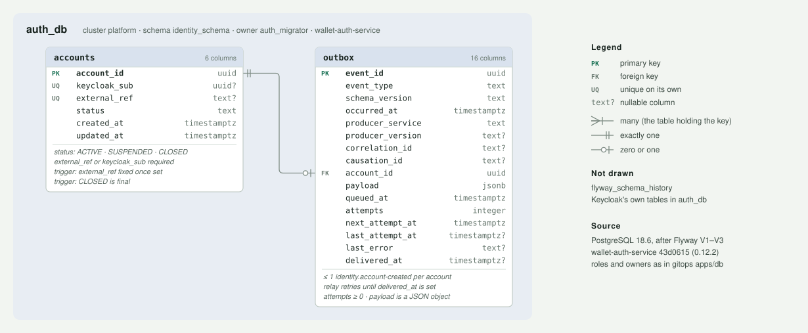

# `identity_schema` — generated schema

> **Generated from a real database.** A throwaway PostgreSQL is migrated by Flyway from
> `src/main/resources/db/migration/`, then this page is written from `pg_catalog`. It therefore
> describes what the database *ended up with*, not what the DDL appears to say — including the
> indexes a `UNIQUE` constraint created, the system names that show up in error messages, and the
> trigger timing. Do not edit by hand.

Database `auth_db`, schema `identity_schema` · PostgreSQL **18.6** · Flyway **12.4.0**

| Migration | Description | Checksum |
| --- | --- | --- |
| `V1` | identity | `-413149361` |
| `V2` | grant app role | `1131095152` |
| `V3` | outbox | `-1805509267` |

## `accounts`

Vaullet's own record of a user: the identifier money is keyed to, and its status. Holds no personal data in either identity mode (ADR-006, ADR-014).

| | Column | Type | Null | Default |
| --- | --- | --- | --- | --- |
| `PK` | `account_id` | `uuid` | — |  |
| `UK` | `keycloak_sub` | `uuid` | **nullable** |  |
| `UK` | `external_ref` | `text` | **nullable** |  |
|  | `status` | `text` | — |  |
|  | `created_at` | `timestamp with time zone` | — | `now()` |
|  | `updated_at` | `timestamp with time zone` | — | `now()` |

### What each column is for

- **`account_id`** — Permanent. Keys seven years of immutable ledger journal, so it must outlive Keycloak, a realm re-import, or a change of identity provider.
- **`keycloak_sub`** — Keycloak user id. NULL = unlinked anchor: provisioned before the user ever authenticated. Set by just-in-time provisioning at first login.
- **`external_ref`** — The operator's own user id. Unique per deployment and immutable once set (ADR-012); immutability is enforced by the accounts_invariants trigger.
- **`status`** — ACTIVE | SUSPENDED | CLOSED. Authoritative here, not in Keycloak: a fraud lock the operator's directory could overrule is not a fraud lock. CLOSED is terminal.

### Constraints

| Name | Kind | Definition |
| --- | --- | --- |
| `accounts_external_ref_not_blank_ck` | CHECK | `CHECK (((external_ref IS NULL) OR (length(btrim(external_ref)) > 0)))` |
| `accounts_natural_key_ck` | CHECK | `CHECK (((external_ref IS NOT NULL) OR (keycloak_sub IS NOT NULL)))` |
| `accounts_status_ck` | CHECK | `CHECK ((status = ANY (ARRAY['ACTIVE'::text, 'SUSPENDED'::text, 'CLOSED'::text])))` |
| `accounts_pk` | PRIMARY KEY | `PRIMARY KEY (account_id)` |
| `accounts_external_ref_uk` | UNIQUE | `UNIQUE (external_ref)` |
| `accounts_keycloak_sub_uk` | UNIQUE | `UNIQUE (keycloak_sub)` |

### Indexes

| Name | Definition |
| --- | --- |
| `accounts_external_ref_uk` | `CREATE UNIQUE INDEX accounts_external_ref_uk ON identity_schema.accounts USING btree (external_ref)` |
| `accounts_keycloak_sub_uk` | `CREATE UNIQUE INDEX accounts_keycloak_sub_uk ON identity_schema.accounts USING btree (keycloak_sub)` |
| `accounts_pk` | `CREATE UNIQUE INDEX accounts_pk ON identity_schema.accounts USING btree (account_id)` |

### Triggers

- **`accounts_invariants`** — `CREATE TRIGGER accounts_invariants BEFORE UPDATE ON identity_schema.accounts FOR EACH ROW EXECUTE FUNCTION identity_schema.accounts_enforce_invariants()`

## `outbox`

Events committed with the change they describe, delivered afterwards by the relay (#39). Each row is an ADR-007 envelope plus its delivery state. identity.account-created is delivered over HTTP as the ledger's POST /v1/wallets, REAL then BONUS, until there is Kafka.

| | Column | Type | Null | Default |
| --- | --- | --- | --- | --- |
| `PK` | `event_id` | `uuid` | — |  |
|  | `event_type` | `text` | — |  |
|  | `schema_version` | `text` | — |  |
|  | `occurred_at` | `timestamp with time zone` | — |  |
|  | `producer_service` | `text` | — |  |
|  | `producer_version` | `text` | **nullable** |  |
|  | `correlation_id` | `text` | **nullable** |  |
|  | `causation_id` | `text` | **nullable** |  |
| `FK` | `account_id` | `uuid` | — |  |
|  | `payload` | `jsonb` | — |  |
|  | `queued_at` | `timestamp with time zone` | — | `now()` |
|  | `attempts` | `integer` | — | `0` |
|  | `next_attempt_at` | `timestamp with time zone` | — | `now()` |
|  | `last_attempt_at` | `timestamp with time zone` | **nullable** |  |
|  | `last_error` | `text` | **nullable** |  |
|  | `delivered_at` | `timestamp with time zone` | **nullable** |  |

### What each column is for

- **`event_id`** — ADR-007 event_id. Consumers dedupe on it.
- **`occurred_at`** — When the account was created: its created_at.
- **`producer_version`** — The build that wrote the row. NULL for rows V3 backfilled and for the demo seed.
- **`correlation_id`** — Trace id of the request that created the account, as in its error bodies. NULL where no request was at hand: backfilled, swept and seeded rows.
- **`causation_id`** — ADR-007 causation_id: the event_id of the event that caused this one. NULL for identity.account-created, which a request causes, not an event.
- **`queued_at`** — When the row was written. Later than occurred_at for rows queued after the account's own transaction: by V3's backfill or by the relay's sweep.
- **`next_attempt_at`** — When the entry is next due. Pushed a lease ahead when a relay claims it, a backoff ahead when an attempt fails.
- **`last_error`** — Why the last attempt failed. Kept after delivery.
- **`delivered_at`** — NULL until the work is done: for identity.account-created, both wallets exist in the ledger or were closed there.

### Constraints

| Name | Kind | Definition |
| --- | --- | --- |
| `outbox_attempts_ck` | CHECK | `CHECK ((attempts >= 0))` |
| `outbox_event_type_ck` | CHECK | `CHECK ((event_type = 'identity.account-created'::text))` |
| `outbox_payload_ck` | CHECK | `CHECK ((jsonb_typeof(payload) = 'object'::text))` |
| `outbox_account_fk` | FOREIGN KEY | `FOREIGN KEY (account_id) REFERENCES identity_schema.accounts(account_id)` |
| `outbox_pk` | PRIMARY KEY | `PRIMARY KEY (event_id)` |

### Indexes

| Name | Definition |
| --- | --- |
| `outbox_account_created_uk` | `CREATE UNIQUE INDEX outbox_account_created_uk ON identity_schema.outbox USING btree (account_id) WHERE (event_type = 'identity.account-created'::text)` |
| `outbox_due_ix` | `CREATE INDEX outbox_due_ix ON identity_schema.outbox USING btree (next_attempt_at) WHERE (delivered_at IS NULL)` |
| `outbox_pk` | `CREATE UNIQUE INDEX outbox_pk ON identity_schema.outbox USING btree (event_id)` |

## Privileges

An owner holds every privilege on what it owns. The other columns are what has been granted to
other roles, as the access control lists record it.

| Object | Owner | `auth_app` |
| --- | --- | --- |
| schema `identity_schema` | `auth_migrator` | `USAGE` |
| `accounts` | `auth_migrator` | `SELECT`, `INSERT`, `UPDATE` |
| `flyway_schema_history` | `auth_migrator` | — |
| `outbox` | `auth_migrator` | `SELECT`, `INSERT`, `UPDATE` |

### Default privileges

What a role's *future* objects are granted as they are created, without a `GRANT` of their own:

| Created by | In schema | Objects | Granted to | Privileges |
| --- | --- | --- | --- | --- |
| `auth_migrator` | `identity_schema` | sequences | `auth_app` | `SELECT`, `USAGE` |
| `auth_migrator` | `identity_schema` | tables | `auth_app` | `SELECT`, `INSERT`, `UPDATE` |

## Diagram

<picture>
  <source media="(prefers-color-scheme: dark)" srcset="erd-dark.svg">
  
</picture>

## Other objects

| Kind | Name |
| --- | --- |
| function (plpgsql) | `accounts_enforce_invariants` |
| table (Flyway-owned) | `flyway_schema_history` |

Full DDL as the database reports it: [`schema.sql`](schema.sql). Machine-readable catalog: [`schema.json`](schema.json).
